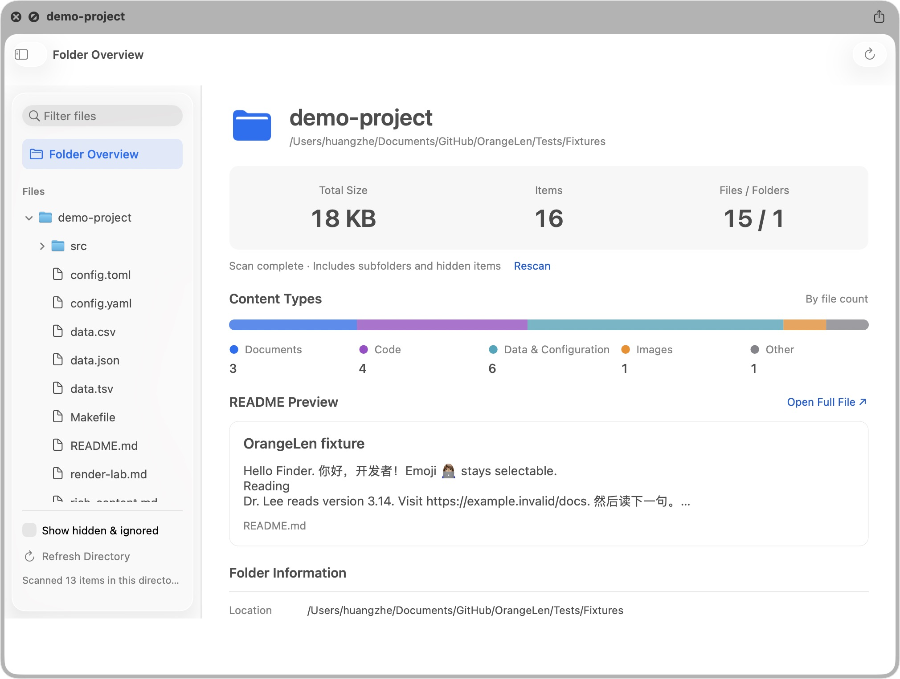

# OrangeLen

**Press Space to preview everything.**

A macOS preview tool for developers, covering whole folders, code, documents, AI workflows, data and 3D models. Select a file or folder in Finder and press Space to take a look.

[中文](README.md) · English

[Download](#download) · [Quick start](#quick-start) · [Supported formats](#supported-formats) · [Compared with system Quick Look](#compared-with-system-quick-look) · [Open-source alternatives](#compared-with-open-source-alternatives) · [Developer guide](docs/development-guide.md) · [Changelog](CHANGELOG.md)

## Product demo (English voiceover and subtitles)

https://github.com/user-attachments/assets/40021fc3-a691-45a7-ac52-3543c6601d5b



*Captured in Finder Quick Look: a file tree, folder statistics and README overview. English and Simplified Chinese interfaces are supported.*

## Download

**[Download OrangeLen installer (DMG)](https://github.com/orange90/OrangeLen/releases/download/V1.0.2/OrangeLen-1.0.2-universal.dmg)** · [Release notes and checksum](https://github.com/orange90/OrangeLen/releases/tag/V1.0.2)

Requires **macOS 14 or later**. The universal installer includes Apple Silicon and Intel architectures. Open the DMG, drag `OrangeLen.app` into `Applications`, then launch it.

**After installing or updating, launch OrangeLen once** so macOS can register its Quick Look extensions, then return to Finder and press Space to preview files.

This **V1.0.2 release is Developer ID signed and Apple notarized**. Both the app and DMG have stapled notarization tickets and pass Gatekeeper verification. Intel hardware and other macOS versions have not been fully verified.

V1.0.2 adds missing SQL, INI, CONFIG, TOML and Markdown type declarations, reducing reliance on installed developer tools or editors. See the [release notes](docs/releases/V1.0.2.md).

## The best preview tool for the AI era

Preview the code, reports, web pages and workflows your AI creates as soon as they are saved. Open a project folder to read its README, browse code, see rendered pages and inspect Skill or MCP package contents in one window.

| What you want to see | How OrangeLen shows it |
| --- | --- |
| **Whole projects** | Expand the file tree and browse files in one window; see README content, file-type distribution, counts and sizes in the overview |
| **Code and configuration** | Offline highlighting, line numbers, search and exact source copy; recognition of Dockerfiles, lockfiles and common configuration filenames |
| **Reports and notes** | Markdown outlines, math, Mermaid, footnotes and code-block copying; continuous notebook reading with saved outputs; EPUB chapters |
| **Web pages and components** | HTML page and source switching; single-file JSX / TSX / MDX component snapshots; basic LaTeX and single-file Typst typesetting previews |
| **Skills and developer packages** | `.skill` opens `SKILL.md` first; inspect MCPB / DXT, wheel / VSIX manifests and members without extracting to disk |
| **Workflows and diagrams** | ComfyUI / n8n / Dify nodes and connections; Draw.io, Excalidraw, JSON Canvas, Mermaid and DOT diagrams |
| **Mind maps** | XMind sheets, FreeMind / Freeplane, OPML and MindManager topic trees with automatic layout |
| **Data and model files** | JSON trees, CSV / TSV filtering and sorting, SQLite pages; Parquet / Arrow / Feather V2 tables, NumPy samples and Safetensors / GGUF / ONNX metadata |
| **Test and API reports** | JUnit results, SARIF security reports and OpenAPI summaries; HAR request records, subtitle tables and diff views |
| **3D and archives** | Rotate and zoom static OBJ / STL / GLTF / GLB models; browse ZIP / 7z / RAR / TAR and compressed TAR members |

English and Simplified Chinese, with light and dark appearances. Files refresh after saving, reading positions can be remembered, and large text loads in pages. Images, PDFs, media and Office content also open within folder previews; see the [system-format scope](docs/system-preview.md).

## Compared with system Quick Look

OrangeLen extends Quick Look for development and AI file inspection. macOS already provides useful PDF, photo and media previews; OrangeLen adds directory browsing and specialized content views.

| Scenario | System Quick Look, without relevant third-party extensions | What OrangeLen adds |
| --- | --- | --- |
| Project folder | Usually basic folder information | Expandable file tree, project overview and in-window reading |
| Code and configuration | Basic previews for recognized text types; behavior varies | Offline highlighting, line numbers, search, exact source copy and named configuration recognition |
| Markdown reports | Depends on OS version and type handler | Outline, GFM tables, math, Mermaid and source switching |
| JSON / CSV / SQLite | Text or built-in views, without a unified structured browser | JSON trees and path copying, table filtering/sorting and SQLite pagination |
| Skills, MCP and workflows | No dedicated manifests or workflow node views for these formats | Package browsing, manifest summaries and ComfyUI / n8n / Dify graphs |
| React components | No JSX / TSX component execution environment | Offline single-file component snapshots and source views |
| Scientific data and model files | Basic information or system-supported content, depending on type | Data tables, array shapes, tensor catalogs and ONNX graph-node metadata |
| 3D files | Some system 3D types; support depends on format | Explicit static OBJ / STL / GLTF / GLB previews |
| PDFs, photos and media | Mature native previews; markup or trimming for some types | Native viewing integrated into folder browsing; focused on inspection |

Baseline: [Apple’s Quick Look guide](https://support.apple.com/en-sg/guide/mac-help/-mh14119/mac). Behavior varies with macOS, file types and installed extensions; this is not an exhaustive cross-version test. **macOS selects the handler for individual Finder files. OrangeLen’s app and folder previews provide the more complete entry points.**

## Compared with open-source alternatives

The reader covers **371 explicit extensions and 49 special filenames**, with folder browsing, source views, workflow graphs, package members, data samples and model catalogs.

Reviewed **2026-10-17**. OrangeLen refers to the published **V1.0** build; the download above includes the features shown here.

| Capability | OrangeLen (V1.0) | QLMarkdown 1.5.7 | Syntax Highlight 2.1.32 | Glance 1.6.0 (chamburr fork) |
| --- | --- | --- | --- | --- |
| Price | **Free (current version)** | Free | Free | Free |
| Explicit suffixes / documented scope¹ | **371 + 49 special filenames** | 9+ document suffixes | 200+ source/configuration suffixes | No fixed total published |
| Project folders | **Tree, overview and member reading in one window** | No dedicated feature listed | No dedicated feature listed | No dedicated feature listed |
| Source highlighting | Offline highlighting, line numbers, search and copy | Fenced code blocks | **Broad language support; configurable LSP, VCS and preprocessors** | Multiple source languages |
| Markdown / Notebook | Math, Mermaid; notebook cells and saved outputs | **Markdown specialist; math, Mermaid, MDX documents and `.mdc`** | Notebook as JSON source | Markdown and notebook rendering |
| Skill / MCP / developer packages | **`.skill`, `.mcpb`, `.dxt`, wheel and VSIX inventories/members** | No dedicated parser listed | No dedicated parser listed | Generic archives; no dedicated package inventory listed |
| ComfyUI / n8n / Dify | **Workflow nodes and connections** | No dedicated parser listed | Generic JSON/YAML source | Generic JSON/YAML source |
| Parquet / Arrow / Feather V2 | **Columns and bounded data samples** | No dedicated parser listed | No dedicated parser listed | No dedicated parser listed |
| NumPy / GGUF / Safetensors / ONNX | **Array samples, tensor inventories or graph-node metadata** | No dedicated parser listed | No dedicated parser listed | No dedicated parser listed |
| JUnit / SARIF / OpenAPI | **Test, security and API summaries** | No dedicated parser listed | Generic XML/JSON/YAML source | Generic XML/JSON/YAML source |
| Components / diagrams / 3D | **Single-file JSX/TSX/MDX snapshots, mind maps, DOT and static 3D** | Mermaid; MDX without JSX rendering | Corresponding source/text | Corresponding source; no dedicated renderer listed |
| Generic archives | ZIP / 7z / RAR / TAR; gzip, XZ, BZIP2 and Zstandard TAR | TextBundle documents | No archive browser listed | **7z / ZIP / TAR and others** |

¹ Suffix aliases count separately; these are not language counts or complete format implementations. Published counts use different methods and do not establish a “most formats” ranking. “No dedicated feature/parser listed” reflects official documentation and our earlier implementation review; generic text or system fallback may still work. All four are free, so price is not a unique advantage.

**Verification:** all 215 new suffixes were checked in Finder: OrangeLen handled 213; the system handled `.text`/`.wflow`, whose native content and OrangeLen folder-reading paths were also verified. This is not exhaustive verification of all existing suffixes. Models are metadata-only; components, diagrams and 3D have subset limits. See the [full comparison, sources and limits](docs/competitor-comparison-public-2026-10-16.md).

## Supported formats

**371 distinct file extensions are explicitly listed below.** This counts extensions, not programming languages or fully implemented format specifications. Aliases such as `.md` and `.markdown` count separately; multiple uses of one extension count once.

**2026-10-26 local development build audit:** all 371 suffixes were checked in Finder: 350 reached OrangeLen, 16 displayed system-provided content, and 5 displayed file metadata only (`.ts`, `.mts`, `.dot`, `.txz`, `.tbz2`). Extension callback logs corroborated all 350 OrangeLen cases. The machine's existing disabled Hydra 3D extension setting was retained. That audit used a development build with the SQL fix; it is not a full rerun of the new release or a claim of complete format compatibility. See the [per-suffix results and test profile](docs/evidence/all-formats-2026-10-26/file-list.md).

**Follow-up fixes on the same day:** the remaining 21 suffixes were individually retested with Finder Space and callback logs. Ten now reach OrangeLen (TXZ, TBZ2, ZSH, BASH, R, PROTO, LOG, DIFF, PATCH, WFLOW); eleven still use system providers, including metadata-only TS/MTS/DOT. WFLOW requires a reversible Shortcuts extension preference that also affects system action cards for `.shortcut`. SQL and the nine exact-type fixes are now included in V1.0.1; WFLOW remains opt-in and is not enabled by installation. See [results, per-file evidence and restoration](docs/evidence/provider-fixes-2026-10-26/README.md).

| Category | Count | Extensions | Preview |
| --- | ---: | --- | --- |
| Code & web | 75 | `.swift`, `.py`, `.js`, `.ts`, `.tsx`, `.jsx`, `.mjs`, `.cjs`, `.mts`, `.cts`, `.vue`, `.svelte`, `.astro`, `.c`, `.h`, `.cpp`, `.hpp`, `.rs`, `.go`, `.sh`, `.zsh`, `.bash`, `.rb`, `.java`, `.kt`, `.css`, `.scss`, `.sass`, `.less`, `.html`, `.htm`, `.xhtml`, `.sql`, `.cs`, `.php`, `.dart`, `.lua`, `.r`, `.scala`, `.ps1`, `.proto`, `.graphql`, `.gql`, `.tf`, `.tfvars`, `.hcl`, `.pyi`, `.pyx`, `.pxd`, `.pxi`, `.cu`, `.cuh`, `.cc`, `.cxx`, `.hh`, `.hxx`, `.ipp`, `.tpp`, `.inl`, `.kts`, `.gradle`, `.groovy`, `.cmake`, `.mk`, `.mdc`, `.http`, `.rest`, `.j2`, `.jinja`, `.jinja2`, `.tmpl`, `.tpl`, `.rst`, `.adoc`, `.asciidoc` | Highlighted source; HTML pages; single-file JSX/TSX snapshots |
| Text & configuration | 11 | `.txt`, `.log`, `.ini`, `.conf`, `.config`, `.properties`, `.plist`, `.yaml`, `.yml`, `.toml`, `.xml` | Source reading and search |
| Documents & typesetting | 8 | `.md`, `.markdown`, `.mdx`, `.tex`, `.typ`, `.ipynb`, `.epub`, `.pdf` | Markdown math and diagrams, saved notebook outputs, books and PDFs; basic LaTeX and single-file Typst |
| Structured data | 12 | `.json`, `.jsonc`, `.json5`, `.jsonl`, `.ndjson`, `.csv`, `.tsv`, `.sqlite`, `.sqlite3`, `.db`, `.har`, `.sarif` | Trees, records, tables or request logs; no user SQL or network requests |
| Diagrams & canvases | 12 | `.mmd`, `.mermaid`, `.excalidraw`, `.drawio`, `.canvas`, `.svg`, `.xmind`, `.mm`, `.opml`, `.mmap`, `.dot`, `.gv` | Visual and source views; supported subsets for complex formats |
| Skills, MCP & archives | 18 | `.skill`, `.mcpb`, `.dxt`, `.n8np`, `.zip`, `.tar`, `.tgz`, `.gz`, `.whl`, `.vsix`, `.7z`, `.rar`, `.xz`, `.bz2`, `.zst`, `.txz`, `.tbz2`, `.tzst` | Manifests, file trees and on-demand member previews; no installation or execution |
| 3D models | 4 | `.obj`, `.stl`, `.gltf`, `.glb` | Static meshes and scenes, rotation and zoom |
| Scientific data & model catalogs | 10 | `.parquet`, `.npy`, `.npz`, `.safetensors`, `.gguf`, `.latent`, `.arrow`, `.ipc`, `.feather`, `.onnx` | Schemas, array samples or tensor metadata; no model inference |
| Subtitles, diffs & provenance | 6 | `.srt`, `.vtt`, `.diff`, `.patch`, `.xmp`, `.c2pa` | Subtitle tables, changed lines, metadata source and unverified C2PA structure |
| Additional developer sources, configs & compiled files | 215 | `.a3x`, `.acf`, `.ada`, `.ado`, `.applescript`, `.as`, `.ascr`, `.asd`, `.asm`, `.asp`, `.aspx`, `.atl`, `.au3`, `.avt`, `.awk`, `.bas`, `.bashrc`, `.basic`, `.bat`, `.bb`, `.bezel`, `.bib`, `.c++`, `.cfc`, `.cfg`, `.cfm`, `.cfml`, `.class`, `.cli`, `.clj`, `.cljc`, `.cljs`, `.cls`, `.cmd`, `.code-workspace`, `.coffee`, `.command`, `.con`, `.cp`, `.cr`, `.csh`, `.cson`, `.csproj`, `.ctx`, `.d`, `.designspace`, `.do`, `.dockerfile`, `.dtd`, `.dylan`, `.e`, `.ecf`, `.ecore`, `.edn`, `.el`, `.entitlements`, `.env`, `.erb`, `.erl`, `.ex`, `.exs`, `.f`, `.f90`, `.f95`, `.fea`, `.fish`, `.flow`, `.fnc`, `.for`, `.fs`, `.fsx`, `.fxml`, `.gd`, `.gemfile`, `.gleam`, `.gpx`, `.haml`, `.heex`, `.hri`, `.hrl`, `.hs`, `.ily`, `.iml`, `.inf`, `.ino`, `.iss`, `.jav`, `.javascript`, `.jl`, `.jnlp`, `.jscript`, `.jsm`, `.jsp`, `.kml`, `.kmt`, `.ksh`, `.latex`, `.lay`, `.ld`, `.lhs`, `.lisp`, `.loctable`, `.lsp`, `.ltx`, `.ly`, `.m`, `.mak`, `.map`, `.mf`, `.mill`, `.ml`, `.mll`, `.mly`, `.mobileconfig`, `.mpd`, `.mq4`, `.mq5`, `.ms`, `.mvw`, `.mxml`, `.ncx`, `.nf`, `.nim`, `.nix`, `.opf`, `.otio`, `.pas`, `.pck`, `.pddl`, `.pde`, `.ph3`, `.ph4`, `.php3`, `.php4`, `.phtml`, `.pkb`, `.pks`, `.pl`, `.pm`, `.podspec`, `.pom`, `.prc`, `.pro`, `.psd1`, `.psjs`, `.psm1`, `.pub`, `.py3`, `.raml`, `.rbw`, `.rdf`, `.readme`, `.rex`, `.rexx`, `.rhtml`, `.rjs`, `.rkt`, `.robot`, `.s79`, `.sage`, `.sas`, `.sbt`, `.sc`, `.scad`, `.sch`, `.scl`, `.scm`, `.scpt`, `.sequ`, `.sld`, `.sls`, `.smali`, `.sol`, `.sps`, `.sqs`, `.ss`, `.storybard`, `.storyboard`, `.strings`, `.stringsdict`, `.sty`, `.t`, `.tab`, `.tcl`, `.tcsh`, `.texi`, `.text`, `.tfstate`, `.tpb`, `.tps`, `.trg`, `.ttx`, `.twig`, `.unity`, `.v`, `.vb`, `.vbs`, `.vhd`, `.vhdl`, `.vim`, `.vl`, `.vw`, `.wflow`, `.xaml`, `.xcscheme`, `.xib`, `.xm`, `.xq`, `.xquery`, `.xsd`, `.xu`, `.xul`, `.zig`, `.zon`, `.zshrc` | More source grammars; binary plist, Java class and AppleScript inspection; see scope below |
| **Total** | **371** | **Distinct extensions** | **Source, structure or rendered views, depending on format** |

Also supported:

- **49 special filenames and 7 prefix rules**, including `Dockerfile`, `Makefile`, `.env`, `.gitignore`, `.editorconfig`, ecosystem lockfiles, `.env.local` and `Dockerfile.dev`. See the [full counting inventory](docs/format-count.md).
- **Whole folders / project directories** with a file tree, overview and on-demand reading; excluded from the extension count.
- **Content-aware workflow detection** for ComfyUI / n8n JSON, Dify YAML and OpenAPI JSON; these reuse JSON / YAML extensions and are not counted again.
- **System-format integration** for ImageIO images, AVKit media, Word / RTF / ODT and XLSX / PPTX content. Availability depends on the OS and file; these are excluded from the fixed count. See [system-format scope](docs/system-preview.md).

See the [auditable inventory](docs/format-count.md), [advanced preview limits](docs/advanced-output-previews.md) and [Finder verification matrix](docs/format-support.md). Detailed engineering documents currently include Chinese content.

### Specialized formats and Finder routing

- **Mind maps:** XMind supports modern JSON and legacy XML workbooks with sheet selection; FreeMind / OPML show topic hierarchies; MindManager reads `.mmap` topics and floating topics. All use automatic layout rather than fully reproducing original styles, notes or attachments. Objective-C++ `.mm` remains source text; legacy `.mmp` is unsupported. See [XMind](docs/evidence/xmind-2026-10-15/README.md), [FreeMind / OPML](docs/evidence/outline-2026-10-15/README.md) and [MindManager](docs/evidence/mmap-2026-10-15/README.md).
- **Archives:** 7z, RAR4/RAR5, ZIP, TAR and gzip / XZ / BZIP2 / Zstandard TAR. Counted `.xz` / `.bz2` / `.zst` suffixes refer to compressed TAR, not arbitrary single-file streams. Encrypted, multi-volume and over-budget archives are unsupported. See [archive scope](docs/archive-formats.md).
- **Compiled files:** binary plist content, Java class declarations and bytecode, and compiled AppleScript source inspection. Compiled AutoIt has a limited byte view. See [source and compiled-format scope](docs/syntax-highlight-parity.md).
- **Finder routing:** macOS chooses the preview provider. Recorded individual-file limitations remain for `.ts` / `.mts`, `.dot` and `.cursorrules`. `.text` / `.wflow` keep their system previews and are readable through OrangeLen folder previews. The format inventory does not mean OrangeLen directly handles every suffix in Finder.

<details>
<summary>Finder verification results by batch</summary>

All 215 added source/configuration suffixes were individually checked: OrangeLen handled 213; system providers handled `.text` / `.wflow`. Their native content and OrangeLen folder routes were also verified. See the [215-suffix audit](docs/evidence/source-parity-finder-2026-10-16/README.md).

For the earlier 106-suffix baseline, 104 primary samples showed content with the reversible STL/OBJ native setting enabled; `.ts` / `.mts` showed basic information only. The first developer batch passed 40/42 direct Finder samples; `.dot` / `.cursorrules` use folder previews. These batches have different scopes and are not combined into an overall pass rate. See [native routing results](docs/evidence/single-file-dispatch-2026-10-13/README.md), [developer-format verification](docs/evidence/developer-batch1-2026-10-15/README.md) and [archive verification](docs/archive-formats.md).

</details>

## Quick start

Use the [installer above](#download), or build from source. Deployment target: **macOS 14**. Recorded testing primarily uses Apple M3 Pro / macOS 26.6.2; builds use Xcode 26.5. Other OS versions and Intel hardware are not fully verified.

From the repository root, with Xcode installed:

```sh
./scripts/install-dev.sh
open ~/Applications/OrangeLen.app
```

The installer builds the app and installs it into `~/Applications`. The first build downloads pinned Swift dependencies.

1. Select a file or folder in Finder and press **Space**.
2. In a folder preview, expand the sidebar and select a file to read it on the right.
3. Alternatively, use **⌘O** in OrangeLen to open a file or folder, and **⌘,** for settings.

If OrangeLen does not appear, check Quick Look extensions in System Settings, then close and reopen the preview. Some individual files remain system-handled; use the app or folder entry point. See [Finder setup](docs/development-guide.md#finder).

## Scope and limits

- Components are single-file snapshots; 3D scenes are static; Office content previews do not promise layout fidelity.
- Previews do not install Skill / MCP packages, execute workflows, start notebook kernels or run model inference. React components evaluate in an isolated, network-blocked WebKit environment.
- Files are read-only. Large text uses pages; structures, archives and media have resource limits. C2PA views show structure without verifying authenticity.
- Local Markdown images and related resources require directory access; remote images load after a click. HTML previews allow scripts and network resources.

See the [current entry-point contract](docs/current-contract.md) and [security and resource limits](docs/development-guide.md#safety-and-limits).

## Development and feedback

```sh
./scripts/build.sh
./scripts/test.sh
./scripts/test-native.sh
```

Source suffix fixtures are generated before testing (requires Python 3 and macOS’s `osacompile`); `Tests/Fixtures/source-parity/` is not versioned. Direct SwiftPM and Xcode test runs also prepare these fixtures automatically.

Reproducible issues, synthetic fixtures and improvement suggestions are welcome. Include your macOS version, architecture, file extension and entry point: individual Finder file, folder preview or app. Do not attach private files or signing material.

[Architecture](docs/architecture.md) · [Build, signing and uninstall](docs/development-guide.md) · [Verification](docs/verification.md) · [Dependencies and license notes](docs/dependencies.md) · [Changelog](CHANGELOG.md)
