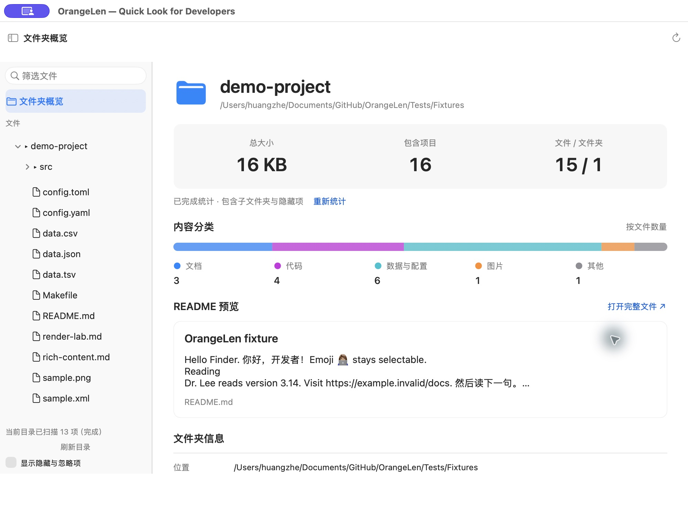
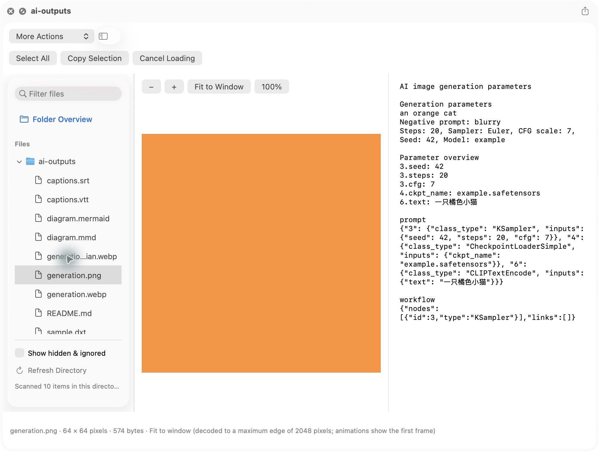

# OrangeLen

**按下空格，看懂整个项目与 AI 产出。**

为开发者设计的 macOS 快速预览工具。**阅读器覆盖 371 种文件后缀、49 个特殊文件名、整个文件夹预览**，覆盖代码、Markdown、Skill / MCP 包、AI 工作流、数据集与 3D 模型。本轮新增的 **215 个后缀已逐项 Finder 空格实测：213 项由 OrangeLen 展示，`.text` / `.wflow` 由系统接管**，两者也可在 OrangeLen 文件夹预览中读取。详见 [215 项逐项结果](docs/evidence/source-parity-finder-2026-10-16/README.md)；既有 STL/OBJ、TS/MTS 等限制另见 [原生入口实测](docs/evidence/single-file-dispatch-2026-10-13/README.md)。

中文 · [English](README.en.md)

[下载安装](#下载) · [快速开始](#快速开始) · [支持格式](#支持格式) · [与系统预览对比](#与系统预览对比) · [开源竞品压缩包格式现在支持哪几种？为什么没有打败竞品？对比](#与开源竞品对比) · [开发文档](docs/development-guide.md) · [更新日志](CHANGELOG.md)

## 产品演示（中文配音与字幕）

https://github.com/user-attachments/assets/3421e382-f677-4088-9150-1a6428989489



*真实应用截图：选中整个文件夹，从项目概览进入代码、文档和数据。*

## 下载

**[下载 OrangeLen 安装包（DMG）](https://github.com/orange90/OrangeLen/releases/download/v0.1.0-preview.2/OrangeLen-0.1.0-preview.2-universal.dmg)** · [Release 说明与校验值](https://github.com/orange90/OrangeLen/releases/tag/v0.1.0-preview.2)

适用于 **macOS 14 及以上**，通用安装包包含 Apple Silicon 与 Intel 架构。打开 DMG，将 `OrangeLen.app` 拖入 `Applications`，再启动应用。

当前为 **0.1.0-preview.2 预览版，已使用 Developer ID 签名并通过 Apple 公证**。应用与 DMG 均附有公证票据，并通过 Gatekeeper 校验。签名开发者显示为 **Zhe Huang**。Intel 实机与其他 macOS 版本尚未完整验收。

## AI 写完了，先看一眼

一轮 AI 协作，可能留下一个项目目录、一份研究报告、一个 Skill、一张工作流图和一个 3D 模型。OrangeLen 把检查这些文件的过程放进熟悉的空格预览：展开目录，点选文件，看效果，再切回源码核对。

| 亮点 | 你可以直接做什么 |
| --- | --- |
| **整个文件夹都能预览** | 展开多层目录，在同一窗口连续查看文件；看 README、项目声明线索、文件数量与大小 |
| **代码与文档一起读** | 源码高亮、行号、查找与复制；Markdown 大纲、公式、Mermaid 图；JSON 可展开结构 |
| **Skill / MCP 包先看后用** | `.skill` 优先打开 `SKILL.md`；MCPB / DXT 查看清单与成员；无需解压到磁盘 |
| **AI 工作流直接看连线** | 查看 ComfyUI、n8n、Dify 的节点图，以及 Draw.io、Excalidraw 和 JSON Canvas |
| **组件与模型看得到效果** | JSX / TSX / MDX 单文件组件快照；OBJ / STL / GLTF / GLB 静态 3D 预览、旋转与缩放 |
| **生成结果连同参数一起看** | 图片里已有的 prompt、seed、模型参数；Parquet / NumPy 样本；Safetensors / GGUF 张量目录 |

原生 macOS 界面，支持简体中文与英文、浅色与深色外观。专用渲染引擎随应用打包；HTML 允许脚本与网络资源，Markdown 远程图片点击后加载。

<details>
<summary>查看 AI 图片参数预览截图</summary>



*合成测试图片，用于展示参数面板。只读取文件已有的参数，不推断缺失信息。*

</details>

## 与系统预览对比

OrangeLen 扩展 macOS Quick Look，让空格预览更适合开发与 AI 文件检查。系统预览本身很适合 PDF、照片和音视频；OrangeLen 的增量在于目录浏览和文件内容的专用展示。

| 场景 | 系统 Quick Look（未安装相关第三方扩展） | OrangeLen 增加的能力 |
| --- | --- | --- |
| 整个项目目录 | 通常显示文件夹基本信息 | 可展开的目录树、项目概览、同窗阅读文件 |
| 源码与配置 | 可识别文本的基础预览，随类型而异 | 离线语法高亮、行号、查找、原文复制与配置文件名识别 |
| Markdown 报告 | 显示取决于系统版本和类型处理器 | 大纲、GFM 表格、公式、Mermaid 与源码切换 |
| JSON / CSV / SQLite | 文本或系统自带展示，缺少统一的结构浏览 | JSON 树与路径复制、表格筛选排序、SQLite 分页 |
| Skill / MCP / 工作流 | 没有这些格式的专用包清单或工作流节点视图 | 包内文件浏览、清单概览、ComfyUI / n8n / Dify 连线图 |
| React 组件 | 没有 JSX / TSX 组件效果运行环境 | 单文件离线效果快照与源码切换 |
| AI 图片与模型文件 | 图片画面或文件基本信息，取决于类型 | 已保存的生成参数、模型张量目录与数组样本 |
| 3D 文件 | 支持部分系统 3D 类型，依格式而定 | 明确提供 OBJ / STL / GLTF / GLB 静态场景预览 |
| PDF、照片、音视频 | 成熟的原生预览，部分格式可标记或剪辑 | 在文件夹阅读流程中整合原生查看；不以编辑为目标 |

系统基线参考 [Apple Quick Look 使用说明](https://support.apple.com/en-sg/guide/mac-help/-mh14119/mac)。具体展示受 macOS 版本、文件类型和已装扩展影响；本表不是对所有系统版本的逐格式测试。**Finder 单文件由系统决定调用哪个预览器；OrangeLen 主应用和文件夹预览是更完整的功能入口。**

## 与开源竞品对比

**一个窗口，连续检查项目目录、代码和 AI 产物。** 本轮补充 215 个源码及配置后缀，并扩展 7z、RAR 与压缩 TAR 支持，阅读器共覆盖 **371 个明确后缀、49 个特殊文件名**；除了阅读源码，还能查看工作流连线、包内成员、数据样本和模型目录。

以下对比沿用此前选定的三款开源工具，核对日期为 **2026-10-17**。OrangeLen 列对应当前仓库开发版（含本轮归档扩展）；**上方公开下载的 preview.2 尚未包含本轮新增功能**。

| 对比项 | OrangeLen（当前开发版） | QLMarkdown 1.5.7 | Syntax Highlight 2.1.32 | Glance 1.6.0（chamburr 开源版） |
| --- | --- | --- | --- | --- |
| 价格 | **免费（当前版本）** | 免费 | 免费 | 免费 |
| 明确后缀 / 公开支持规模¹ | **371 个，另有 49 个特殊文件名** | 9+ 个文档后缀 | 200+ 个源码及配置后缀 | 未公布固定总数 |
| 文件夹与项目浏览 | **目录树、项目概览、同窗阅读成员** | 未列专门功能 | 未列专门功能 | 未列专门功能 |
| 源码高亮 | 离线高亮、行号、查找与复制 | 文档内代码块 | **广泛语言覆盖；可配 LSP、VCS 和预处理器** | 多语言源码高亮 |
| Markdown / Notebook | 公式、Mermaid；Notebook 单元格及已存输出 | **Markdown 专长，含公式、Mermaid、MDX 文档及 `.mdc`** | Notebook 按 JSON 源码 | Markdown、Notebook 渲染 |
| Skill / MCP / 开发包 | **`.skill` / `.mcpb` / `.dxt` / wheel / VSIX 清单与成员** | 未列专门解析 | 未列专门解析 | 通用归档；未列专门包清单 |
| ComfyUI / n8n / Dify | **工作流节点与连线** | 未列专门解析 | 通用 JSON/YAML 源码 | 通用 JSON/YAML 源码 |
| Parquet / Arrow / Feather V2 | **字段与预算内数据样本表格** | 未列专门解析 | 未列专门解析 | 未列专门解析 |
| NumPy / GGUF / Safetensors / ONNX | **数组样本、张量目录或图节点元数据** | 未列专门解析 | 未列专门解析 | 未列专门解析 |
| JUnit / SARIF / OpenAPI | **测试结果、安全报告、接口摘要** | 未列专门解析 | 通用 XML/JSON/YAML 源码 | 通用 XML/JSON/YAML 源码 |
| 组件 / 图表 / 3D | **JSX/TSX/MDX 单文件快照、导图、DOT、静态 3D** | Mermaid；MDX 不渲染 JSX | 对应源码高亮或文本 | 对应源码；未列专门渲染 |
| 通用归档 | ZIP / 7z / RAR / TAR；gzip、XZ、BZIP2、Zstandard TAR | TextBundle 文档包 | 未列归档目录浏览 | **7z / ZIP / TAR 等** |

¹ 后缀别名分别计数，不是语言数或完整格式数；竞品公开数字口径不同，不能据此判断谁“支持最多”。“未列专门功能/解析”指所核对版本的官方说明及此前实现核查未见对应专用入口，通用文本或系统兜底仍可能可用。四款均免费，价格不是 OrangeLen 的独有优势。

**实测依据：**新增 215 个后缀逐项 Finder 验收，213 项由 OrangeLen 展示；`.text` / `.wflow` 由系统接管，已验证原生正文及 OrangeLen 文件夹阅读入口。其他既有后缀不据此视为全量通过。模型只读元数据；组件、导图和 3D 有子集限制。详见 [完整对比、来源及边界](docs/competitor-comparison-public-2026-10-16.md)。

## 支持格式

**当前明确列出 371 个不重复的文件扩展名**，详见下表；这是后缀计数，不是 371 种编程语言，也不代表所有格式都完整渲染。`.md` / `.markdown` 等别名分别计数；同一个后缀的多个用途只计一次。

| 类别 | 数量 | 扩展名 | 预览内容 |
| --- | ---: | --- | --- |
| 代码与网页 | 75 | `.swift`, `.py`, `.js`, `.ts`, `.tsx`, `.jsx`, `.mjs`, `.cjs`, `.mts`, `.cts`, `.vue`, `.svelte`, `.astro`, `.c`, `.h`, `.cpp`, `.hpp`, `.rs`, `.go`, `.sh`, `.zsh`, `.bash`, `.rb`, `.java`, `.kt`, `.css`, `.scss`, `.sass`, `.less`, `.html`, `.htm`, `.xhtml`, `.sql`, `.cs`, `.php`, `.dart`, `.lua`, `.r`, `.scala`, `.ps1`, `.proto`, `.graphql`, `.gql`, `.tf`, `.tfvars`, `.hcl`, `.pyi`, `.pyx`, `.pxd`, `.pxi`, `.cu`, `.cuh`, `.cc`, `.cxx`, `.hh`, `.hxx`, `.ipp`, `.tpp`, `.inl`, `.kts`, `.gradle`, `.groovy`, `.cmake`, `.mk`, `.mdc`, `.http`, `.rest`, `.j2`, `.jinja`, `.jinja2`, `.tmpl`, `.tpl`, `.rst`, `.adoc`, `.asciidoc` | 源码高亮；HTML 页面；JSX/TSX 单文件组件快照 |
| 文本与配置 | 11 | `.txt`, `.log`, `.ini`, `.conf`, `.config`, `.properties`, `.plist`, `.yaml`, `.yml`, `.toml`, `.xml` | 原文阅读与查找 |
| 文档与排版 | 8 | `.md`, `.markdown`, `.mdx`, `.tex`, `.typ`, `.ipynb`, `.epub`, `.pdf` | Markdown 公式与图表、Notebook 已存输出、电子书、PDF；LaTeX 基础子集与单文件 Typst |
| 结构化数据 | 12 | `.json`, `.jsonc`, `.json5`, `.jsonl`, `.ndjson`, `.csv`, `.tsv`, `.sqlite`, `.sqlite3`, `.db`, `.har`, `.sarif` | 结构树、记录、表格或请求记录；不执行 SQL 或网络请求 |
| 图表与画布 | 12 | `.mmd`, `.mermaid`, `.excalidraw`, `.drawio`, `.canvas`, `.svg`, `.xmind`, `.mm`, `.opml`, `.mmap`, `.dot`, `.gv` | 图形与源码；复杂格式采用受支持的子集 |
| Skill、MCP 与归档 | 18 | `.skill`, `.mcpb`, `.dxt`, `.n8np`, `.zip`, `.tar`, `.tgz`, `.gz`, `.whl`, `.vsix`, `.7z`, `.rar`, `.xz`, `.bz2`, `.zst`, `.txz`, `.tbz2`, `.tzst` | 包清单、目录树、按需查看成员；不安装或执行 |
| 3D 模型 | 4 | `.obj`, `.stl`, `.gltf`, `.glb` | 静态网格与场景、旋转、缩放 |
| 科学数据与模型目录 | 10 | `.parquet`, `.npy`, `.npz`, `.safetensors`, `.gguf`, `.latent`, `.arrow`, `.ipc`, `.feather`, `.onnx` | 列信息、数组样本或张量元数据；不运行模型 |
| 字幕、差异与来源结构 | 6 | `.srt`, `.vtt`, `.diff`, `.patch`, `.xmp`, `.c2pa` | 字幕表、增删行、参数源码、未验证的 C2PA 结构 |
| 新增开发者源码、配置与编译文件 | 215 | `.a3x`, `.acf`, `.ada`, `.ado`, `.applescript`, `.as`, `.ascr`, `.asd`, `.asm`, `.asp`, `.aspx`, `.atl`, `.au3`, `.avt`, `.awk`, `.bas`, `.bashrc`, `.basic`, `.bat`, `.bb`, `.bezel`, `.bib`, `.c++`, `.cfc`, `.cfg`, `.cfm`, `.cfml`, `.class`, `.cli`, `.clj`, `.cljc`, `.cljs`, `.cls`, `.cmd`, `.code-workspace`, `.coffee`, `.command`, `.con`, `.cp`, `.cr`, `.csh`, `.cson`, `.csproj`, `.ctx`, `.d`, `.designspace`, `.do`, `.dockerfile`, `.dtd`, `.dylan`, `.e`, `.ecf`, `.ecore`, `.edn`, `.el`, `.entitlements`, `.env`, `.erb`, `.erl`, `.ex`, `.exs`, `.f`, `.f90`, `.f95`, `.fea`, `.fish`, `.flow`, `.fnc`, `.for`, `.fs`, `.fsx`, `.fxml`, `.gd`, `.gemfile`, `.gleam`, `.gpx`, `.haml`, `.heex`, `.hri`, `.hrl`, `.hs`, `.ily`, `.iml`, `.inf`, `.ino`, `.iss`, `.jav`, `.javascript`, `.jl`, `.jnlp`, `.jscript`, `.jsm`, `.jsp`, `.kml`, `.kmt`, `.ksh`, `.latex`, `.lay`, `.ld`, `.lhs`, `.lisp`, `.loctable`, `.lsp`, `.ltx`, `.ly`, `.m`, `.mak`, `.map`, `.mf`, `.mill`, `.ml`, `.mll`, `.mly`, `.mobileconfig`, `.mpd`, `.mq4`, `.mq5`, `.ms`, `.mvw`, `.mxml`, `.ncx`, `.nf`, `.nim`, `.nix`, `.opf`, `.otio`, `.pas`, `.pck`, `.pddl`, `.pde`, `.ph3`, `.ph4`, `.php3`, `.php4`, `.phtml`, `.pkb`, `.pks`, `.pl`, `.pm`, `.podspec`, `.pom`, `.prc`, `.pro`, `.psd1`, `.psjs`, `.psm1`, `.pub`, `.py3`, `.raml`, `.rbw`, `.rdf`, `.readme`, `.rex`, `.rexx`, `.rhtml`, `.rjs`, `.rkt`, `.robot`, `.s79`, `.sage`, `.sas`, `.sbt`, `.sc`, `.scad`, `.sch`, `.scl`, `.scm`, `.scpt`, `.sequ`, `.sld`, `.sls`, `.smali`, `.sol`, `.sps`, `.sqs`, `.ss`, `.storybard`, `.storyboard`, `.strings`, `.stringsdict`, `.sty`, `.t`, `.tab`, `.tcl`, `.tcsh`, `.texi`, `.text`, `.tfstate`, `.tpb`, `.tps`, `.trg`, `.ttx`, `.twig`, `.unity`, `.v`, `.vb`, `.vbs`, `.vhd`, `.vhdl`, `.vim`, `.vl`, `.vw`, `.wflow`, `.xaml`, `.xcscheme`, `.xib`, `.xm`, `.xq`, `.xquery`, `.xsd`, `.xu`, `.xul`, `.zig`, `.zon`, `.zshrc` | 更多语言源码；二进制 plist、Java class 与 AppleScript 内容检查，详见支持边界 |
| **合计** | **371** | **不重复后缀** | **源码、结构或效果预览，依格式而定** |

XMind：支持新版 `content.json` 和旧版 `content.xml` 工作簿，多画布切换、主题树与关系连线。使用自动树状布局，不还原原始样式、图片、附件、备注及概要。最多 50 张画布、总计 2000 个主题，沿用归档读取安全预算。

此外还支持：

- **49 个特殊文件名与 7 组前缀规则**：如 `Dockerfile`、`Makefile`、`.env`、`.gitignore`、`.editorconfig`、`Cargo.lock`、`yarn.lock` 等依赖锁文件，以及 `.env.local`、`Dockerfile.dev` 等。完整名单见 [统计口径](docs/format-count.md)。
- **整个文件夹 / 项目目录**：目录树、项目概览、按需阅读；不计入文件后缀总数。
- **AI 工作流内容识别**：ComfyUI / n8n JSON、Dify YAML、OpenAPI JSON，复用已有 JSON / YAML 后缀，不重复加数。
- **系统格式整合**：ImageIO 图片、AVKit 音视频、Word / RTF / ODT、XLSX / PPTX 内容预览。能力依赖系统和具体文件，未计入上述固定总数；详见 [系统格式范围](docs/system-preview.md)。

统计依据见 [可复核的格式清单](docs/format-count.md)。专用预览的限制见 [高级 AI 产出](docs/advanced-output-previews.md)；实际 Finder 验证见 [支持矩阵](docs/format-support.md)。

本地开发修复已完成 106 种后缀的单文件与文件夹阅读器共 212 次检查，均通过；106 项 Finder Space 现场操作已完成：启用可恢复的 STL/OBJ 原生预览设置后，104 项主样例显示内容，`.ts` / `.mts` 仍仅基本信息。STL 的单三角、二进制及 ASCII 模型已通过。详见 [最新原生修复与限制](docs/evidence/single-file-dispatch-2026-10-13/README.md)及 [106 项完整实测清单](docs/evidence/single-file-audit-2026-10-13/README.md)。上述下载的 `preview.1` 不含本次未发布修复。

## 快速开始

可直接使用上方[安装包](#下载)，也可从源码构建。最低部署目标为 **macOS 14**，已记录的主要实测环境为 Apple M3 Pro / macOS 26.6.2，构建使用 Xcode 26.5。其他系统和 Intel 实机尚未完整验收。

在仓库根目录运行（需安装 Xcode）：

```sh
./scripts/install-dev.sh
open ~/Applications/OrangeLen.app
```

安装脚本会先构建，再安装到 `~/Applications`。首次构建需联网获取固定版本的 Swift 依赖。

1. 在 Finder 选中文件或文件夹，按 **空格**。
2. 预览文件夹时，展开左侧目录并点选文件，在右侧查看内容。
3. 也可在 OrangeLen 中按 **⌘O** 打开文件或目录，用 **⌘,** 调整设置。

未出现 OrangeLen 时，检查系统设置中的 Quick Look 扩展，并关闭后重新打开预览。部分类型仍由系统处理，可从主应用或文件夹入口查看。详细步骤见 [Finder 配置](docs/development-guide.md#finder)。

## 使用边界

- 组件效果是单文件快照；3D 为静态场景；Office 内容预览不保证版式保真。
- 预览不安装 Skill / MCP 包、不执行工作流、不启动 Notebook kernel、不加载模型推理。React 组件在隔离、禁网的 WebKit 环境中求值。
- 文件只读；大型文本按页加载，结构、归档和媒体各有资源上限。C2PA 只展示结构，不验证真实性。
- Markdown 本地图片及关联资源需要目录权限；HTML 预览允许脚本和网络资源。

详见 [当前入口与边界](docs/current-contract.md) 和 [安全与资源限制](docs/development-guide.md#safety-and-limits)。

## 开发与反馈

```sh
./scripts/build.sh
./scripts/test.sh
./scripts/test-native.sh
```

源码后缀测试样例会在测试前自动生成（需要 Python 3 和 macOS 自带的 `osacompile`），无需提交 `Tests/Fixtures/source-parity/`。直接运行 SwiftPM 或 Xcode 测试也会自动准备这些样例。

欢迎提供可复现的问题、合成示例和改进建议。报告问题时请注明 macOS、芯片架构、文件后缀，以及使用的是 Finder 单文件、文件夹还是主应用入口；请勿附带私人文件或签名材料。

[架构](docs/architecture.md) · [构建、签名与卸载](docs/development-guide.md) · [验证记录](docs/verification.md) · [依赖与许可证说明](docs/dependencies.md) · [更新日志](CHANGELOG.md)

FreeMind / Freeplane `.mm` 与 OPML `.opml`：自动树状布局、主题层级、FreeMind 关系箭头与富文本标题的纯文本内容；可切换源码。原始样式、备注、附件不还原，链接不访问。最多 2000 个主题，输入限 1 MiB。普通 Objective-C++ `.mm` 源码仍显示为文本。

MindManager `.mmap`：读取 ZIP 中的 `Document.xml`，预览主题层级和浮动主题。使用自动树状布局，不还原原始样式、关系线、备注、任务字段和附件；加密文件及旧版 `.mmp` 不支持。最多 2000 个主题，沿用 ZIP/XML 安全预算。

开发者格式首批：新增 Python/Cython、CUDA/C++、构建脚本、模板及规则文件后缀；Arrow IPC/Feather V2 表格（含 LZ4/ZSTD）、wheel/VSIX 目录与元信息、JUnit/SARIF/OpenAPI 摘要、ONNX 图节点与张量目录、离线 DOT 图形。具体范围与 Finder 记录见 [首批验收](docs/evidence/developer-batch1-2026-10-15/README.md)。

本批直接 Finder 验收 40/42 个正常样例通过；`.dot` 与 `.cursorrules` 需通过文件夹预览入口读取。此结果不等于全部 371 个后缀均直接 Finder 通过。

本次开发版补齐 Syntax Highlight 格式清单；编译文件及 Finder 入口边界见 [支持与验证说明](docs/syntax-highlight-parity.md)。公开 preview.2 尚未包含这些新增功能。

新增归档：7z、RAR4/RAR5、`.tar.xz` / `.txz`、`.tar.bz2` / `.tbz2`、`.tar.zst` / `.tzst`，目录与受支持成员均在内存中只读浏览。`.xz` / `.bz2` / `.zst` 在上述计数中代表压缩 TAR 的末级后缀，不承诺任意单文件压缩流。加密、分卷及超出预算的归档不支持。详见 [归档范围与验收](docs/archive-formats.md)。
